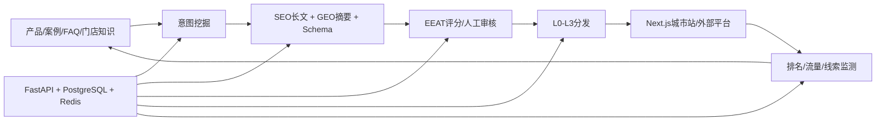

# 博雅敏格 SEO/GEO 双引擎智能体｜技术方案设计文档

## 1. 架构

## 2. 选型与职责

Next.js 负责可索引主站、城市/门店/文章页面和后台入口；FastAPI 负责意图、知识、内容、审核、分发、线索和指标；PostgreSQL 存结构化业务，Redis 处理缓存/任务/客服会话；Nginx/TLS 提供网关。

## 3. 内容流水线

内容对象绑定城市、意图、知识版本和本地证据。生成产物包含长文、摘要、标题、Schema、引用与风险标记；EEAT 低分进入补证或人工处理。分发适配器按平台能力分 L0—L3，回执决定状态，内容包不冒充自动发布。

## 4. 多城市防重复

模板只定义结构，不复制事实。建立事实块、案例归属、门店覆盖、相似度阈值和发布频控；城市无证据时改为通用区域内容或拒绝生成，避免 doorway pages 和虚假本地化。

## 5. 统一数据方案

整合后由本地地图系统维护城市、经销商、门店、线索和权限主数据；SEO/GEO 服务维护意图、内容、证据、分发和搜索效果，通过事件回写 `content_attribution`，避免双向主数据冲突。

## 6. 安全可靠性

上传/客服/线索 PII 加密；模型调用脱敏；发布限速、幂等和审计；数据库备份与恢复；真实排名/发布 API 失败不回退伪结果。
